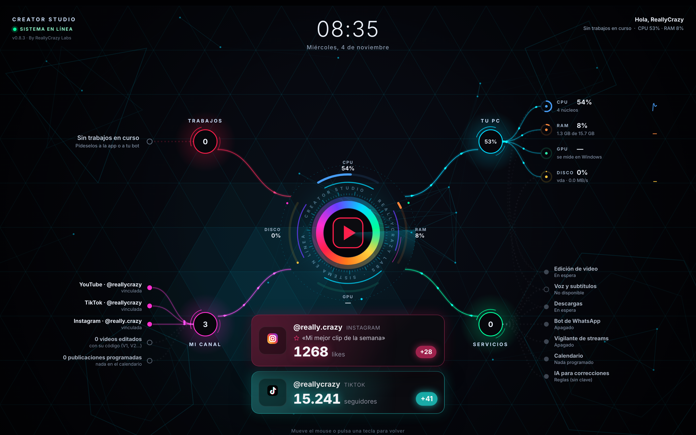
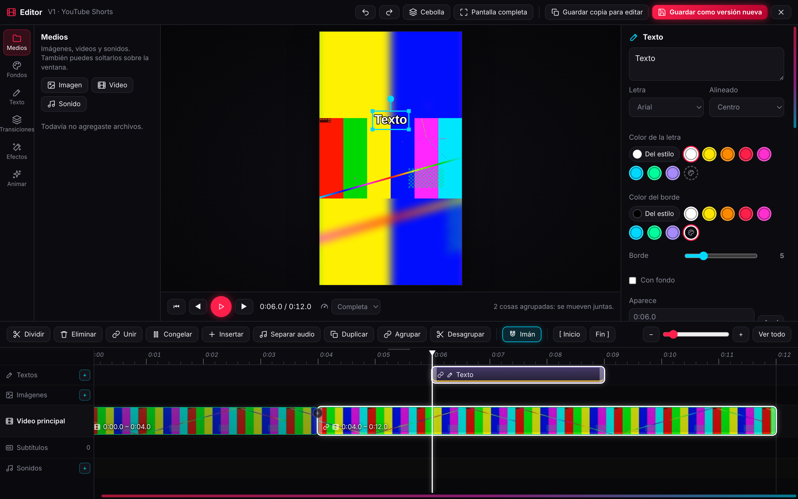
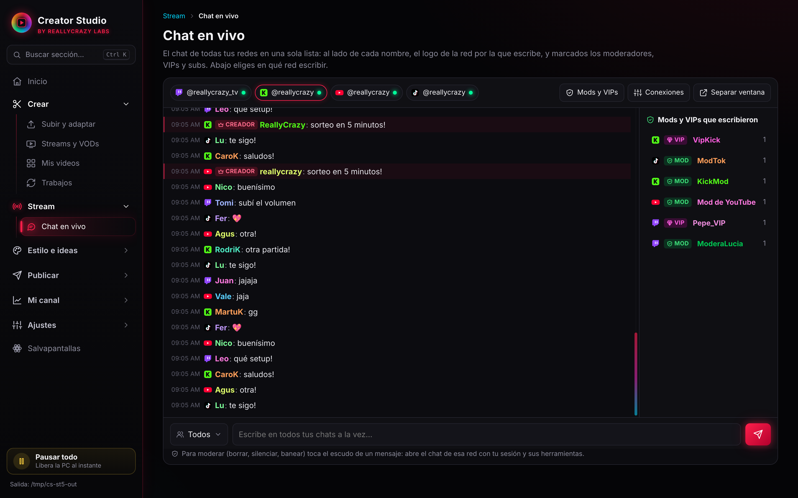
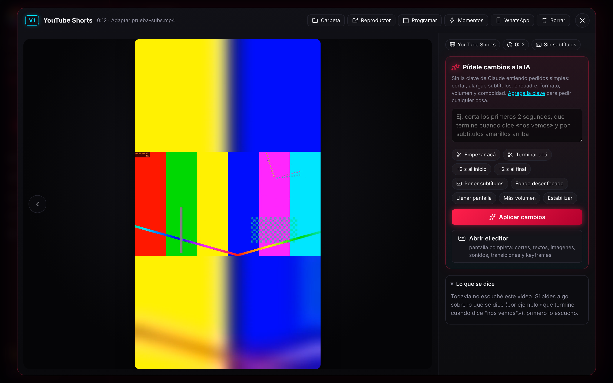
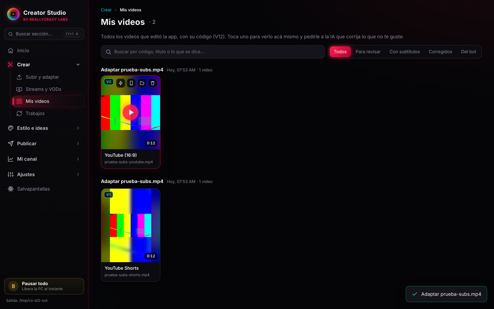
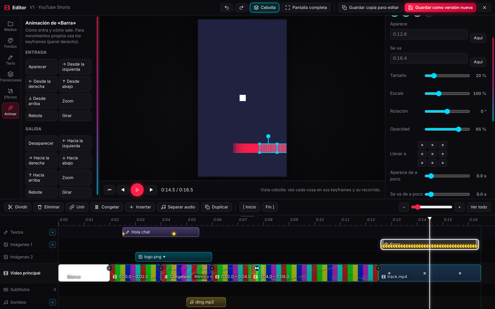
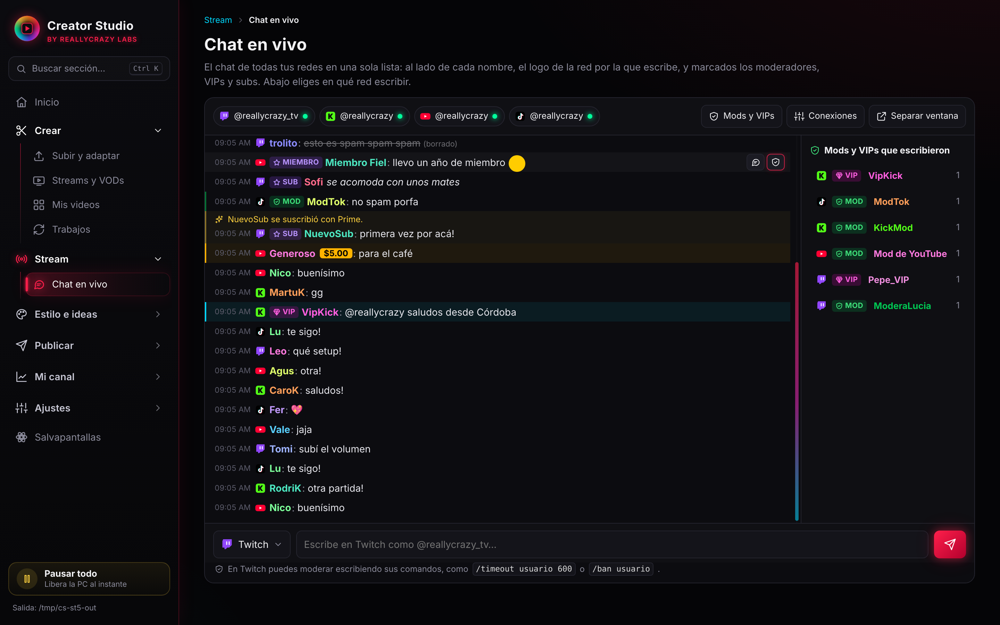
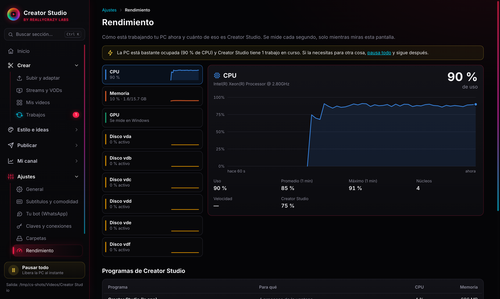
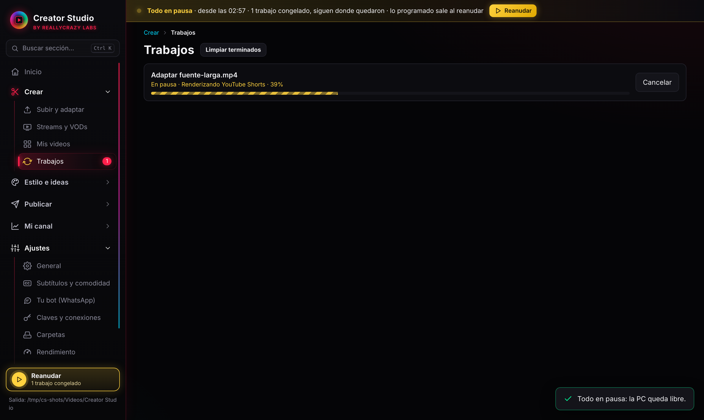

<div align="center">

# 🎬 Creator Studio

**Tu estudio de contenido en una sola app de escritorio.**
Edita sola tus streams, adapta cada video a todas las redes, pone subtítulos, junta el chat de tus directos y te deja manejarlo todo desde WhatsApp.

[](../../releases/latest)
[](../../releases/latest)
[](https://www.electronjs.org/)
[](https://ffmpeg.org/)

[**⬇️ Descargar**](../../releases/latest) · [Qué hace](#-qué-hace) · [Capturas](#-capturas) · [Instalar](#-instalar) · [Desarrollo](#-desarrollo)



</div>

---

## ✨ Qué hace

<table>
<tr>
<td width="50%" valign="top">

### ✂️ Edición automática
- **Streams → clips**: busca tus VODs de Twitch, Kick, YouTube y TikTok, encuentra los mejores momentos (gritos, risas, hype) y saca **clips verticales**, una **compilación** o el **stream sin tiempos muertos**.
- **Clips a la medida**: cada clip empieza y termina en una pausa, nunca a mitad de frase.
- **Una versión por red**: TikTok, Shorts, Reels, YouTube, Instagram 4:5, cuadrado y X, con el formato y la duración que pide cada una.
- **Jump cuts, zoom dinámico y volumen parejo**, de forma automática.

</td>
<td width="50%" valign="top">

### 🎞️ Editor de video
- Línea de tiempo con **capas** de video, imágenes, textos y sonidos.
- Dividir con **B**, **selección múltiple**, **agrupar** video y sonido, **imán** a los bordes.
- **Velocidad** con Shift + arrastrar (0,25× a 4×).
- **Keyframes**, animaciones, transiciones, efectos y **seguimiento de objetos**.
- Vista previa con **calidad ajustable** para PCs modestas.

</td>
</tr>
<tr>
<td valign="top">

### 💬 Chat en vivo unificado
- **Twitch, Kick, YouTube y TikTok** en una sola lista, cada mensaje con el logo de su red.
- Marca **mods, VIPs, subs y miembros**, emotes, Super Chats y menciones.
- Escribes eligiendo la red, o en todas a la vez.
- **Ventana aparte** para tenerla junto a OBS, con «siempre encima».

</td>
<td valign="top">

### 🗣️ Subtítulos y calidad
- **Subtítulos automáticos** en tu PC (whisper.cpp), sin subir nada: palabra resaltada, neón, impacto…
- **Comodidad visual**: nota de 0 a 100 por temblores, destellos, oscuridad o cortes bruscos, y un botón para **corregirlo**.
- **Correcciones con IA**: «cortale los primeros 2 segundos y ponele subtítulos amarillos».

</td>
</tr>
<tr>
<td valign="top">

### 🤖 Tu bot de WhatsApp
- Conecta tu asistente de **n8n** y pídele desde WhatsApp:
  *«agarrá mi último stream y sacame los 10 mejores momentos en modo short»*.
- La app edita en tu PC y te manda los videos al chat, cada uno con su código.

</td>
<td valign="top">

### 📅 Publicar y crecer
- **Calendario** con los mejores horarios de cada red y subida automática a YouTube, Instagram y Facebook.
- **Anuncios en X** con plantillas y variables.
- **Analizar estilos** de otros creadores para editar parecido.
- **Avisos** de seguidores, likes y comentarios nuevos.
- **Ideas** de videos y streams para tu nicho.

</td>
</tr>
</table>

<details>
<summary><b>🧰 Y además…</b></summary>

| | |
|---|---|
| 📚 **Mis videos** | Biblioteca con buscador por código, título o lo que se dice en el video, y previsualizador con transcripción. |
| ⏸️ **Pausar todo** | Congela los programas de la app y la cola de trabajos; al reanudar, todo sigue donde estaba. |
| 📊 **Rendimiento** | CPU, RAM, GPU y discos en vivo, con lo que consume cada trabajo. |
| 🌌 **Salvapantallas** | Panel animado con tus trabajos, tu PC, los servicios y tu canal, con fondo propio desenfocado. |
| 🩺 **Diagnóstico** | Prueba todo con tus cuentas reales en un clic. |
| 🔐 **Privacidad** | Claves y sesiones cifradas con el llavero del sistema; la edición y los subtítulos se hacen en tu PC. |

</details>

---

## 📸 Capturas

<table>
<tr>
<td><p align="center"><sub><b>Editor</b>: capas, grupos e imán</sub></p></td>
<td><p align="center"><sub><b>Chat en vivo</b> de las 4 redes</sub></p></td>
</tr>
<tr>
<td><p align="center"><sub><b>Previsualizador</b> con correcciones</sub></p></td>
<td><p align="center"><sub><b>Mis videos</b></sub></p></td>
</tr>
<tr>
<td><p align="center"><sub><b>Seguimiento</b> de objetos</sub></p></td>
<td><p align="center"><sub><b>Mods y VIPs</b> de cada red</sub></p></td>
</tr>
<tr>
<td><p align="center"><sub><b>Rendimiento</b> de la PC</sub></p></td>
<td><p align="center"><sub><b>Pausar todo</b></sub></p></td>
</tr>
</table>

---

## 🚀 Instalar

> [!TIP]
> No necesita instalación: descomprimes el zip y la abres.

1. Descarga `Creator Studio-X.Y.Z-win.zip` desde **[Releases](../../releases/latest)**.
2. Descomprímelo donde quieras.
3. Abre **`Creator Studio.exe`**.

La primera vez que haga falta, la app descarga sola lo que necesita: `yt-dlp` para los VODs y el motor de voz para los subtítulos (60 a 550 MB según el modelo que elijas). Después los subtítulos funcionan sin internet.

<details>
<summary><b>🔌 Conexiones opcionales</b></summary>

| Servicio | Para qué |
|---|---|
| **YouTube Data API** | Subir videos y Shorts solo |
| **Meta (Instagram / Facebook)** | Subir reels, videos e historias solo |
| **X API** | Publicar anuncios sin abrir el navegador |
| **Anthropic** | Ideas y correcciones con IA (sin clave funcionan con reglas) |
| **n8n + Evolution API** | Manejar la app desde WhatsApp |

Todo se configura en **Ajustes → Claves y conexiones** y se guarda cifrado.
</details>

---

## 🛠️ Desarrollo

```bash
npm install
npm start          # abre la app
npm test           # pruebas de la lógica, el motor de edición, los subtítulos, el bot y más
npm run dist:win   # arma la versión de Windows
```

**Hecho con:** Electron · Node.js · ffmpeg · whisper.cpp · yt-dlp

---

## ⚠️ Limitaciones

- **TikTok** no permite subir videos de forma automática sin una app aprobada: el calendario te deja todo listo para subirlo a mano.
- El **chat en vivo** y algunas estadísticas leen las páginas de cada red; si una red cambia su página, esa parte puede fallar hasta la próxima versión.
- Los **subtítulos** corren en el procesador: un clip es rápido, pero un stream largo puede tardar bastante.
- Para que **el bot** funcione, la app tiene que estar abierta en tu PC.

---

<div align="center">

Hecho por **Abelardo Vicencio** · © 2026 · Todos los derechos reservados

</div>
